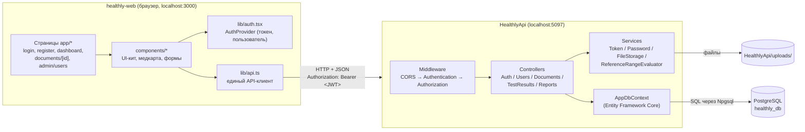

# Healthly — путеводитель по проекту

> Этот файл описывает, **что сделано**, **что осталось**, **как работает каждый процесс** и **где что лежит**.
> Обновляется после каждого этапа работы. Последнее обновление: **22.10.2026** (этапы 0–4 завершены).

---

## Содержание
1. [Что такое Healthly](#1-что-такое-healthly)
2. [Архитектура в одной картинке](#2-архитектура-в-одной-картинке)
3. [Статус: что сделано](#3-статус-что-сделано)
4. [Roadmap: что осталось](#4-roadmap-что-осталось)
5. [Как работают процессы — бэкенд](#5-как-работают-процессы--бэкенд)
6. [Как работают процессы — фронтенд](#6-как-работают-процессы--фронтенд)
7. [Карта файлов и папок](#7-карта-файлов-и-папок)
8. [Запуск проекта](#8-запуск-проекта)
9. [Как проверялось](#9-как-проверялось)
10. [Известные проблемы](#10-известные-проблемы)
11. [Словарь терминов](#11-словарь-терминов)

---

## 1. Что такое Healthly

Медицинская платформа: пациент регистрируется, загружает медицинские документы (анализы), вносит из них показатели
(гемоглобин, глюкоза…), а система сама определяет, выходит ли значение за норму, и собирает сводный отчёт.
Врачи и администраторы видят пациентов и их медкарты; администратор управляет учётными записями.

Проект состоит из **двух независимых приложений** и базы данных:

| Часть | Технологии | Папка | Адрес при разработке |
|---|---|---|---|
| **Бэкенд (API)** | .NET 10, C#, ASP.NET Core, Entity Framework Core | `HealthlyApi/` | `http://localhost:5097` |
| **Фронтенд (сайт)** | Next.js 16, React 19, TypeScript, Tailwind CSS 4 | `healthly-web/` | `http://localhost:3000` |
| **База данных** | PostgreSQL 18 | (на вашем ПК, БД `healthly_db`) | `localhost:5432` |
| **Файлы документов** | папка на диске | `HealthlyApi/uploads/` (не в git) | — |

Они общаются только через **REST API** (HTTP-запросы с JSON). Фронтенд ничего не знает о базе данных —
он только отправляет запросы бэкенду. Это и есть правило «frontend и backend decoupled».

---

## 2. Архитектура в одной картинке



**Слои бэкенда (сверху вниз):**
1. **Middleware** — «фильтры», через которые проходит каждый запрос: CORS (разрешает запросы с сайта), Authentication (читает JWT-токен и определяет, кто пользователь), Authorization (проверяет, можно ли ему вызвать этот метод).
2. **Controllers** — принимают HTTP-запрос, проверяют права, вызывают сервисы/базу и возвращают ответ.
3. **DTO** — «конверты» для данных: что клиент присылает и что получает. Сущности базы наружу не отдаются.
4. **Services** — переиспользуемая логика (токены, пароли, файлы, проверка нормы).
5. **Data (AppDbContext)** — работа с базой через Entity Framework Core (ORM: C#-классы ↔ таблицы).
6. **Models** — C#-классы, которые соответствуют таблицам базы.

**Слои фронтенда:**
1. **Страницы (`app/`)** — адреса сайта. Каждая папка с `page.tsx` = страница.
2. **Компоненты (`components/`)** — переиспользуемые куски интерфейса.
3. **`lib/`** — логика без вёрстки: API-клиент, авторизация, загрузка данных, форматирование.
4. **`types/`** — TypeScript-описания данных, которые приходят из API.

---

## 3. Статус: что сделано

### ✅ До начала работы с Claude (ваш первый коммит)
- .NET 10 API, PostgreSQL через Npgsql, модели `User`, `MedicalDocument`, `TestResult`, 3 миграции.
- `UsersController` с GET (список, по id) и POST.
- Next.js-лендинг с настройкой цветовой темы.

### ✅ Navbar (стеклянное меню)
`components/landing/Navbar.tsx`: плавающая полупрозрачная шапка, логотип, 5 ссылок, Search, кнопки входа.
Теперь знает о входе: гость видит **Log in / Start testing**, вошедший — **Log out / My dashboard**.

### ✅ Этап 0 — Гигиена
| Что | Зачем |
|---|---|
| Пароль БД и ключ JWT → **user-secrets** | Секреты не должны попадать в git |
| Удалена `HealthlyApi/wwwroot` | Старый тестовый HTML-фронт, API его не раздавал |
| `CLAUDE.md` переписан | Правила и контекст проекта |
| `Microsoft.OpenApi` → 2.7.5 | У 2.0.0 была уязвимость высокого уровня |

### ✅ Этап 1 — Users API (полный CRUD)
DTO вместо сущностей (наружу не уходит `PasswordHash`), методы GET/POST/PUT/DELETE с правами по ролям,
валидация (`400`), уникальный email без учёта регистра (`409`), документация Scalar на `/scalar`.

### ✅ Этап 2 — Аутентификация (JWT)
`/api/auth/register`, `/api/auth/login`, `/api/auth/me`; пароли хэшируются (PBKDF2);
автосоздание администратора при запуске в Development.

### ✅ Этап 3 — Медицинские отчёты (бэкенд)
- **Документы**: загрузка файла (PDF/PNG/JPG до 10 МБ), список, скачивание, смена статуса (врач/админ), удаление вместе с файлом.
- **Показатели анализов**: добавление, изменение, удаление. **Флаг «вне нормы» ставится автоматически** по референсному диапазону (`120-160`, `<5`, `>=1.2`…), либо вручную, если диапазон текстовый.
- **Статус документа**: Pending → (врач может поставить Processing) → автоматически **Completed**, когда внесён первый показатель; врач может поставить Error.
- **Сводный отчёт** `GET /api/users/{id}/report`: сколько документов/показателей/отклонений и **последнее значение каждого показателя** (с количеством измерений).
- При удалении пользователя удаляются и его файлы с диска.
- Миграция `AddDocumentFileMetadata`: поля `ContentType`, `FileSizeBytes` и ограничения длины строк.

### ✅ Этап 4 — Фронтенд (рабочий интерфейс)
| Страница | Кто видит | Что умеет |
|---|---|---|
| `/` | все | Лендинг; кнопки ведут на регистрацию/кабинет |
| `/register` | гость | Регистрация по макету Function Health (см. Этап 4.1) |
| `/login` | гость | Вход |
| `/dashboard` | любой вошедший | Профиль + редактирование (модалка), сводка, последние показатели, документы, загрузка |
| `/documents/[id]` | владелец, врач, админ | Файл, статус (врач/админ меняет), таблица показателей, добавить/изменить/удалить (модалки) |
| `/admin/users` | врач, админ | Таблица пользователей, поиск, фильтр по роли; админ: создать/изменить/удалить (модалки, подтверждение) |
| `/admin/users/[id]` | врач, админ | Профиль и медкарта выбранного пользователя |

Также: удалена отладочная вкладка «DB Status» (вместе с багом двойного `fetchUsers`), заголовок вкладки — «Healthly»,
убран неиспользуемый импорт `Lock`. Все тексты интерфейса — на английском.

### ✅ Этап 4.1 — Новая форма регистрации
- `components/auth/RegisterForm.tsx` (кремовый стиль, `AuthLayout` с `wide`): Email, Password, Legal name (First/Last),
  Phone (+90, маска `5XX XXX XX XX`), Date of birth (`MM/DD/YYYY` → отправляется как `YYYY-MM-DD`), Gender (радио Female/Male/Other),
  город сдачи анализов (8 городов Турции), Access code (раскрывающийся блок), 3 чекбокса (маркетинг — необязательный; условия и
  Authorization for Use of Medical Information — обязательные).
- Валидация двойная: на клиенте (сразу, под полями) и на сервере (атрибуты `RegisterRequest` + возраст 18–120 лет в контроллере).
- `User`: новые поля `PhoneNumber` (хранится как `+905321234567`), `DateOfBirth` (`date`), `City`, `AccessCode`, `MarketingOptIn`,
  `ConsentsAcceptedAt` (момент принятия согласий). `FullName` = `"FirstName LastName"`. Миграция `AddUserRegistrationProfile`.
- Допустимые значения — `Models/RegistrationOptions.cs` (`Genders`, `TestingCities`) и `types/api.ts` (`GENDERS`, `TESTING_CITIES`).
- Рост и вес из регистрации убраны — их можно указать в профиле.

### ✅ Этап 4.2 — Health Trends (графики динамики)
- Библиотека **recharts** (`npm i recharts`). Компонент `components/records/HealthTrends.tsx`, встроен в `PatientRecords`
  (виден и пациенту на `/dashboard`, и врачу/админу на `/admin/users/[id]`).
- Новый эндпоинт `GET /api/users/{id}/trends` (см. 5.7) — история числовых значений каждого показателя.
- Один график = один показатель (у показателей разные единицы и масштабы, две оси Y запутывают). Переключение — кнопками.
- На графике: линия значений, бежевая полоса нормы, красные точки — отклонения, подсказка при наведении, кнопка «Show table» (табличный вид).
- Нет показателя с ≥ 2 измерениями → приглушённый демо-график с пометкой «Sample data» и кнопкой «Upload first lab result».
- Проверено: все тексты кабинета (Dashboard, Profile, Documents) на английском; русский только в комментариях.

### ✅ Этап 5.1 — Передача мобильной команде (handoff)
- **`MOBILE_HANDOFF.md`** (в корне, на английском): запуск, базовый URL для эмулятора/телефона/ngrok, JWT, тестовые аккаунты,
  все эндпоинты пациента и врача/админа с примерами JSON, таблица прав, ошибки, примеры кода на Flutter (dio) и React Native.
- **OpenAPI/Scalar:** `GenerateDocumentationFile` в `.csproj` — `/// <summary>`, `<remarks>`, `<response code>` (на английском)
  попадают в документацию. `OpenApi/ApiInfoTransformer.cs` — вводный текст (авторизация, роли, форматы, ошибки).
  `BearerSecurityTransformer` сам добавляет ответ `401` всем защищённым эндпоинтам и `403` эндпоинтам с ролями.
- **Единый формат ошибок:** `Dtos/ErrorResponse.cs` (`{ "message": "..." }`) вместо анонимных объектов; у эндпоинтов с телом —
  `400 ValidationProblemDetails`. Маршруты в нижнем регистре: `/api/auth`, `/api/users` (раньше в Scalar было `/api/Auth`).
- **Демо-аккаунты** (сейчас — `DbInitializer`, см. Этап 5.3; флаг `DemoData:Enabled` в `appsettings.Development.json`):
  `patient@healthly.com` / `Patient123!`, `doctor@healthly.com` / `Doctor123!`,
  `admin@healthly.com` / `Admin123!`. Создаются только если email ещё свободен — существующие пароли не перезаписываются.
- **Профиль запуска `lan`** (`dotnet run --launch-profile lan`) слушает `0.0.0.0:5097` — API доступен с телефона в той же Wi-Fi.
  В Development отключён `UseHttpsRedirection` (иначе http-запросы мобильных клиентов перенаправлялись бы на `https://localhost`).

---

## 4. Roadmap: что осталось

### ✅ Этап 5.2 — Docker
- `HealthlyApi/Dockerfile` — двухэтапная сборка (SDK → рантайм ASP.NET), запуск от непривилегированного пользователя, порт 8080.
- `healthly-web/Dockerfile` — три этапа (npm ci → next build → `output: "standalone"`), Node 24 (как локально: lock-файл npm 11).
  `NEXT_PUBLIC_API_URL` — build-аргумент: адрес API «вшивается» в JS при сборке, т.к. запросы идут из браузера.
- `docker-compose.yml` (корень): `db` (postgres:18, наружу порт **5433**, чтобы не мешать локальному PostgreSQL),
  `api` (5097 → 8080, ждёт healthcheck базы), `web` (3000). Тома: `postgres-data` (база) и `uploads` (PDF/фото отчётов).
  Именованный том, а не папка проекта: проект лежит в OneDrive, и медицинские файлы не должны синхронизироваться в облако.
- Секреты и адреса — `.env` (шаблон `.env.example`, сам `.env` в `.gitignore`); у всех значений есть локальные значения по умолчанию.
- API: `Database:MigrateOnStartup` — применять миграции при старте (включено только в Docker); CORS-адреса из `Cors:Origins`.
- Проверено: `docker compose up -d --build` поднимает всё, демо-аккаунты создаются, файл после `down` + `up --force-recreate` скачивается тем же.

### ✅ Этап 5.3 — Тестовые данные (DbInitializer)
- `DevDataSeeder.cs` заменён на `Data/DbInitializer.cs` (подробно — раздел 5.12): миграции + админ из секретов + 3 демо-аккаунта,
  у каждого история анализов (сахар, холестерин, гемоглобин) за последние 6 месяцев — графики Health Trends сразу с динамикой.
- Флаг `DemoData:ResetHistory` (в Docker — `DEMO_RESET_HISTORY` в `.env`) пересоздаёт историю с актуальными датами.

### ✅ Этап 5.4 — Единый формат ошибок и refresh-токены
- **`Middleware/ExceptionHandlingMiddleware.cs`** — первым в конвейере: любое необработанное исключение → `500` в формате
  ProblemDetails (в Production без подробностей, в Development с текстом исключения), `BadHttpRequestException` → его код.
  `UseStatusCodePages()` даёт тело ProblemDetails пустым ответам (401 от JWT, 403, 404 неизвестного адреса, 405).
  `ProblemDetailsDefaults` добавляет всем ошибкам `traceId`, `instance` и понятный `detail` (для истёкшего токена —
  «Get a new one with POST /api/auth/refresh»). `ProblemDetailsContentTypeFilter` — тип `application/problem+json`
  и у ошибок из контроллеров.
- Контроллеры возвращают `Problem(detail, statusCode)` вместо `{ "message": ... }` (`ErrorResponse` удалён).
  Фронтенд (`lib/api.ts`) читает `detail`, затем `errors`, затем `title`.
- **Refresh-токены** (раздел 5.3): access-токен теперь 15 минут, refresh — 30 дней с ротацией. Таблица `RefreshTokens`
  (миграция `AddRefreshTokens`), `Services/RefreshTokenService.cs`, эндпоинты `POST /api/auth/refresh` и `/logout`.
  Смена пароля админом завершает все сессии пользователя.
- Фронтенд продлевает сессию сам: на `401` один общий запрос `/auth/refresh` и повтор исходного запроса (раздел 6.2).
- Проверено скриптом (23 проверки: ротация, повторное использование, выход, смена пароля, все коды ошибок, CORS у ошибок),
  отдельно — 500 в Production и истёкший токен; в браузере — продление при «испорченном» токене и выход.

### ✅ Этап 5.5 — Уборка, смена пароля, httpOnly-cookie, разбиение лендинга, TEAM_GUIDE
- **`docs/` удалён.** Это был клон этого же репозитория на старом коммите `016182d` (README, README_CONTRIBUTOR, LICENSE),
  в git он числился как gitlink. Перед удалением проверено: других веток, stash и незакоммиченных изменений нет,
  файлы совпадают с коммитом в основной истории. Удаление: `git rm --cached docs` + удаление папки.
- **Смена пароля самим пользователем** — `PUT /api/auth/me/password { currentPassword, newPassword }` (раздел 5.3).
  На фронтенде: кнопка «Change password» в карточке профиля → `components/users/ChangePasswordModal.tsx`.
- **Refresh-токен в httpOnly-cookie для сайта** (разделы 5.3 и 6.2): access-токен — только в памяти вкладки,
  в localStorage больше нет токенов. Мобильные клиенты работают как раньше (токен в JSON).
- Исправлена ошибка обнаружения кражи: повтор токена, отозванного **выходом или сменой пароля** (а не обменом),
  раньше тоже отзывал все сессии — то есть выход на одном устройстве мог «выкинуть» и с других.
- **Лендинг разбит на компоненты**: `app/page.tsx` 787 → 85 строк, секции в `components/landing/` (раздел 6.6).
  Проверено: отрисованный HTML страницы до и после совпадает (772 элемента).
- **`TEAM_GUIDE.md`** — запуск бэкенда (Docker / локально), роли и тестовые аккаунты, Scalar, базовые URL для мобильного приложения.

### ✅ Этап 6 — Подготовка к ИИ: анализ документа, обезличивание, справочник норм
- **`POST /api/documents/{id}/analyze`** — ИИ-анализ документа (раздел 5.14). Пока работает заглушка
  `MockAiDocumentProcessor` (`isMock: true`), формат ответа окончательный — фронтенд и мобильные клиенты могут
  делать экран уже сейчас.
- **`Services/Ai/`**: интерфейс `IAiDocumentProcessor`, заглушка, оркестратор `DocumentAnalysisService`.
  Зарегистрированы в DI (`Program.cs`); реальный OCR + LLM подключается заменой одной строки регистрации.
- **`Services/PiiAnonymizer.cs`** — маскирует e-mail, телефоны (+90 / RU), даты и имена перед отправкой текста в ИИ.
  Живой прогон эндпоинта нашёл утечку («Validated by: Dr. Ayse Demir» не маскировалось) — добавлено правило для имён
  после званий (Dr., Prof., Uzm., д-р…) и тест на него.
- **Справочник норм `ReferenceMedicalValues`** (миграция `AddReferenceMedicalValues`): глюкоза, холестерин,
  гемоглобин, лейкоциты — границы, единицы, категория и врач. Заполняется миграцией (`HasData`), поэтому есть
  в любой среде.
- **Первый тестовый проект** `HealthlyApi.Tests` (xUnit, 21 тест на `PiiAnonymizer`), запуск — `dotnet test` в корне.
  Заодно явно указана версия EF Core в `HealthlyApi.csproj` (иначе тесты получали бы EF 10.0.4 вместо 10.0.13).

### ⏭ Этап 5 — Документация для команды
- [x] Описания эндпоинтов в OpenAPI на английском — см. Этап 5.1 ниже.
- [x] Инструкция по API для мобильной команды — `MOBILE_HANDOFF.md`.
- [x] Удалить вложенный репозиторий `docs/` — см. Этап 5.5.
- [x] Руководство для команды — `TEAM_GUIDE.md`.

### 💡 Идеи на будущее (по желанию, для диплома)
- [ ] Секции `#analyses` и `#faq` на лендинге (ссылки в Navbar уже есть); действие для иконки Search.
- [ ] Автотесты: расширить `HealthlyApi.Tests` (`ReferenceRangeEvaluator`, `RefreshTokenService`), Playwright для фронтенда.
- [ ] Реальный ИИ: реализация `IAiDocumentProcessor` (OCR + LLM), сохранение результата анализа в документ, экран анализа на фронтенде.
- [ ] Экран «мои сессии» с выходом на отдельных устройствах; «забыли пароль» (сброс по email).

---

## 5. Как работают процессы — бэкенд

### 5.1. Регистрация
```
Браузер → POST /api/auth/register  { email, firstName, lastName, password, phoneNumber, dateOfBirth,
                                     gender, city, accessCode?, marketingOptIn, acceptTerms, acceptMedicalAuthorization }
```
1. ASP.NET проверяет DTO `RegisterRequest` по атрибутам (`[Required]`, `[EmailAddress]`, `[MinLength(8)]`, `[AllowedValues]` для пола и города,
   `[RegularExpression]` для телефона, `[Range(true,true)]` для обязательных согласий). Ошибка → `400` со списком полей.
   Затем контроллер проверяет возраст (18–120 лет) → `400` с ошибкой `DateOfBirth`.
2. `AuthController.Register` приводит email к нижнему регистру (`UserMappings.NormalizeEmail`).
3. Проверяет, нет ли такого email в БД → если есть, `409 Conflict`.
4. Создаёт `User` с ролью **Patient** (роль из запроса не берётся — нельзя зарегистрироваться админом);
   `FullName` собирается из имени и фамилии, телефон нормализуется (`UserMappings.NormalizePhone`), `ConsentsAcceptedAt` = текущее время.
5. `PasswordService.Hash` превращает пароль в хэш (PBKDF2 + соль). Сам пароль нигде не сохраняется.
6. Сохраняет в БД, `TokenService` создаёт JWT, ответ `201` → `{ token, expiresAt, user }`.

### 5.2. Вход (login)
1. Ищем пользователя по email.
2. `PasswordService.Verify` хэширует введённый пароль той же солью и сравнивает с сохранённым хэшем.
3. Не нашли или не совпало → `401` с одинаковым сообщением «Invalid email or password» (чтобы нельзя было узнать, какие email зарегистрированы).
4. Совпало → новый JWT.

### 5.3. Что такое JWT и как он проверяется
JWT (JSON Web Token) — строка из трёх частей `header.payload.signature`.
- **Payload**: `sub` (Id пользователя), `email`, `name`, `role`, `exp` (срок годности, 15 минут), `iss`/`aud`.
- **Signature** — подпись секретным ключом `Jwt:Key` (HMAC-SHA256). Подделать токен без ключа нельзя.

Каждый защищённый запрос несёт заголовок `Authorization: Bearer eyJhbGciOi...`:
1. Middleware **Authentication** (`AddJwtBearer` в `Program.cs`) проверяет подпись, срок, issuer, audience → иначе `401`.
2. Из токена собирается `User` (ClaimsPrincipal) — контроллер знает Id и роль: `User.GetUserId()`, `User.IsInRole(...)`, `User.CanAccessUser(id)`.
3. Middleware **Authorization** проверяет `[Authorize]` / `[Authorize(Roles = ...)]` → иначе `403`.

> **401 vs 403:** 401 — «я не знаю, кто ты» (нет/плохой токен). 403 — «я знаю, кто ты, но тебе нельзя».

**Refresh-токены — зачем и как.** JWT нельзя «отозвать»: пока не истёк, он действует. Поэтому access-токен живёт всего
15 минут, а для продления есть второй, долгоживущий **refresh-токен** (30 дней):
1. Вход/регистрация → `{ token, refreshToken }`. Refresh-токен — 32 случайных байта (не JWT). В таблице `RefreshTokens`
   хранится только его **SHA-256-хэш**: даже утечка базы не даёт войти.
2. Access-токен истёк → клиент шлёт `POST /api/auth/refresh { refreshToken }` → получает **новую пару**, а старый
   refresh-токен помечается отозванным (`RevokedAt`, `ReplacedByTokenHash`) — это **ротация**.
3. Если уже обменянный токен приходит снова — его, скорее всего, украли: `RefreshTokenService` отзывает **все** сессии
   пользователя. Исключение — повтор в течение 30 секунд (две вкладки обновились одновременно) — тогда просто `401`.
4. Обмен атомарный: `UPDATE ... WHERE RevokedAt IS NULL` — из двух одновременных запросов выиграет только один.
5. `POST /api/auth/logout` отзывает токен; смена пароля (админом или самим пользователем) отзывает все токены
   пользователя; удаление пользователя удаляет их каскадно. Истёкшие токены чистятся при выдаче новых.
   Кражей считается только повтор **обменянного** токена — повтор токена после выхода или смены пароля даёт просто `401`.

**Смена пароля самим пользователем** — `PUT /api/auth/me/password { currentPassword, newPassword }`:
проверка текущего пароля (неверный → `400` с ошибкой поля `CurrentPassword`, а не `401`, чтобы клиент не принял это
за истёкший токен) → новый хэш → отзыв **всех** refresh-токенов → новая пара токенов для текущего устройства.
Итог: на этом устройстве пользователь остаётся в системе, на остальных — разлогинен.

**Где хранится refresh-токен у сайта — httpOnly-cookie.** Сайт шлёт заголовок `X-Refresh-Token-Transport: cookie`,
и API кладёт refresh-токен не в JSON, а в cookie `healthly_refresh` (`Services/RefreshTokenCookie.cs`):
- `HttpOnly` — JavaScript её не видит, XSS не может украсть долгоживущий токен;
- `SameSite=Strict` — браузер не отправит её с чужого сайта (защита от CSRF); `localhost:3000` и `localhost:5097` —
  один «сайт» (порт не учитывается), поэтому фронтенду она приходит;
- `Path=/api/auth` — уходит только на эндпоинты авторизации; `Secure` — когда API работает по HTTPS.
`/refresh` и `/logout` берут токен из тела, а если его нет — из cookie; ответ приходит тем же способом.
Чтобы браузер отправлял и принимал cookie между портами, в CORS включён `AllowCredentials()`,
а фронтенд делает запросы с `credentials: 'include'`. Мобильные клиенты заголовок не шлют — им всё как раньше.

### 5.4. Права доступа (кто что может)
Общее правило для медданных — `CanAccessUser(userId)`: **сам пользователь, Doctor или Admin**.

| Эндпоинт | Без входа | Patient | Doctor | Admin |
|---|:-:|:-:|:-:|:-:|
| `POST /api/auth/register`, `/login` | ✅ | ✅ | ✅ | ✅ |
| `GET /api/auth/me` | ❌ | ✅ | ✅ | ✅ |
| `GET /api/users` (список, `?role=`) | ❌ | ❌ | ✅ | ✅ |
| `GET /api/users/{id}` | ❌ | только себя | ✅ | ✅ |
| `POST /api/users` (любая роль) | ❌ | ❌ | ❌ | ✅ |
| `PUT /api/users/{id}` | ❌ | себя, без роли/пароля | себя, без роли/пароля | ✅ всё |
| `DELETE /api/users/{id}` | ❌ | ❌ | ❌ | ✅ (кроме себя) |
| `GET/POST /api/users/{id}/documents` | ❌ | свои | ✅ | ✅ |
| `GET /api/documents/{id}`, `/file` | ❌ | свои | ✅ | ✅ |
| `PUT /api/documents/{id}/status` | ❌ | ❌ | ✅ | ✅ |
| `DELETE /api/documents/{id}` | ❌ | свои | ❌ | ✅ |
| `POST /api/documents/{id}/results`, `PUT/DELETE /api/results/{id}` | ❌ | свои | ✅ | ✅ |
| `GET /api/users/{id}/report` | ❌ | свой | ✅ | ✅ |

### 5.5. Загрузка и хранение документов
```
Браузер → POST /api/users/{userId}/documents   (multipart/form-data, поле "file")
```
1. Проверка доступа (`CanAccessUser`) и что пользователь существует.
2. Проверка расширения (только `.pdf .png .jpg .jpeg`) и размера (1 байт … 10 МБ) → иначе `400`.
3. `FileStorageService.SaveAsync` сохраняет файл в `HealthlyApi/uploads/` под **новым именем `GUID.расширение`**.
   Оригинальное имя хранится только в БД (`OriginalFileName`) — так нельзя подсунуть путь вида `../../Program.cs`, и одинаковые имена не конфликтуют.
4. В БД создаётся `MedicalDocument` со статусом `Pending`. Ответ `201`.

Скачивание (`GET /api/documents/{id}/file`): API проверяет права, открывает файл и отдаёт его с исходным именем.
Удаление документа: запись удаляется из БД (показатели — каскадно), затем файл с диска.

### 5.6. Автоматическое определение отклонения от нормы
`Services/ReferenceRangeEvaluator.cs` получает значение и диапазон:

| Диапазон | Значение «вне нормы», если |
|---|---|
| `120-160` (также `120 – 160`, с тире) | меньше 120 или больше 160 |
| `<5` | ≥ 5 |
| `<=5`, `≤5` | > 5 |
| `>1.2` | ≤ 1.2 |
| `>=1.2`, `≥1.2` | < 1.2 |
| текст (`negative`) или нечисловое значение | не определяется → берётся флаг из запроса, иначе «норма» |

Запятая в числе тоже понимается (`7,2` = `7.2`). Если в запросе явно передан `isAbnormal`, он важнее автоматики.

### 5.7. Сводный отчёт
`ReportsController.GetReport` берёт все документы пользователя с показателями и:
1. считает документы, показатели и отклонения;
2. **группирует показатели по названию** (без учёта регистра: `Hemoglobin` = `hemoglobin`);
3. в каждой группе берёт **самое свежее** измерение (по дате загрузки документа);
4. сортирует: сначала отклонения, потом по алфавиту.

`ReportsController.GetTrends` (`GET /api/users/{id}/trends`) — данные для графиков:
1. берёт все показатели пользователя вместе с датой загрузки документа;
2. оставляет только **числовые** значения (`"positive"` на графике не нарисовать);
3. группирует по названию (без учёта регистра), точки сортирует по дате;
4. единицы и диапазон берёт из самого свежего измерения; границы нормы для полосы на графике считает
   `ReferenceRangeEvaluator.GetBounds` (`"120-160"` → 120 и 160, `"<5.2"` → только верхняя граница).

### 5.8. Коды ответов API
| Код | Когда |
|---|---|
| `200 OK` | Успешно, есть данные |
| `201 Created` | Создано (в заголовке `Location` — адрес нового ресурса) |
| `204 No Content` | Успешно удалено |
| `400 Bad Request` | Ошибка валидации, неверный тип/размер файла, удаление себя |
| `401 Unauthorized` | Нет токена / токен неверный или истёк / неверный пароль |
| `403 Forbidden` | Не хватает прав |
| `404 Not Found` | Не найден пользователь / документ / показатель |
| `409 Conflict` | Email уже занят |

| `405 Method Not Allowed` | Неверный HTTP-метод для адреса |
| `500 Internal Server Error` | Ошибка в коде сервера (ловит `ExceptionHandlingMiddleware`) |

Все ошибки — **ProblemDetails** (RFC 9457), `Content-Type: application/problem+json`:
`{ "title": "Not Found", "status": 404, "detail": "User not found", "instance": "GET /api/users/42", "traceId": "..." }`.
У ошибок валидации вместо `detail` — поле `errors` с сообщениями по полям. Источники ошибок:
контроллеры (`Problem()`, `ValidationProblem()`), автоматическая валидация `[ApiController]`,
`UseStatusCodePages` (пустые 401/403/404/405) и `ExceptionHandlingMiddleware` (исключения → 500).
`traceId` в ответе совпадает с записью в логе сервера — по нему ищут причину ошибки.

### 5.9. Секреты и конфигурация
.NET собирает настройки из нескольких источников, более поздние перекрывают ранние:
1. `appsettings.json` — общие настройки (в git, **без паролей**): JWT Issuer/Audience/срок, `Storage:UploadsPath`.
2. `appsettings.Development.json` — настройки для разработки.
3. **user-secrets** — секреты на вашем ПК вне папки проекта (`%APPDATA%\Microsoft\UserSecrets\84ab9b4e-...\secrets.json`). Работают только в Development.

| Ключ в user-secrets | Что это |
|---|---|
| `ConnectionStrings:DefaultConnection` | строка подключения к PostgreSQL (с паролем) |
| `Jwt:Key` | секретный ключ подписи токенов (≥ 32 символов) |
| `SeedAdmin:Email`, `SeedAdmin:Password` | администратор, создаваемый при запуске |

Посмотреть: `dotnet user-secrets list` (в папке `HealthlyApi`).

### 5.10. Миграции базы данных
Миграция — C#-файл, описывающий изменение структуры БД.
1. Меняете модель или `AppDbContext`.
2. `dotnet ef migrations add ИмяМиграции` → EF сравнивает модель со снимком (`AppDbContextModelSnapshot.cs`) и генерирует файл.
3. `dotnet ef database update` → применяет. Применённые миграции записываются в таблицу `__EFMigrationsHistory`.

| Миграция | Что делает |
|---|---|
| `20261020081209_InitialCreate` | таблица `Users` |
| `20261020084926_AddMedicalAndTestTables` | таблицы `MedicalDocuments`, `TestResults` + связи |
| `20261020132607_AddUserHealthMetrics` | поля `Height`, `Weight`, `Gender` |
| `20261022143055_AddUserEmailIndexAndLengths` | уникальный индекс на `Email`, длины строк `Users` |
| `..._AddDocumentFileMetadata` | `ContentType`, `FileSizeBytes` у документа, длины строк документов и показателей |

### 5.11. Связи таблиц
```
Users (1) ──< (много) MedicalDocuments (1) ──< (много) TestResults
```
Удаление каскадное: удалили пользователя → удалились его документы → удалились их показатели (`ON DELETE CASCADE`).

### 5.12. Подготовка базы при запуске (`Data/DbInitializer.cs`)
`Program.cs` вызывает `DbInitializer.InitializeAsync(app)` до приёма запросов:
1. `Database:MigrateOnStartup = true` → `Database.MigrateAsync()` (включено в Docker, где база создаётся пустой).
2. Дальше только в **Development**:
   - **админ из user-secrets**: `SeedAdmin:Email/Password` → создаётся с ролью Admin, если такого email нет
     (нужно, потому что регистрация создаёт только пациентов);
   - **демо-аккаунты** (`DemoData:Enabled`): `patient@`, `doctor@`, `admin@healthly.com`. Каждому, у кого нет документов,
     добавляется **история за 6 месяцев**: 6 документов (раз в месяц, последний — неделю назад) с показателями
     Glucose, Cholesterol, Hemoglobin. Флаг `IsAbnormal` считает тот же `ReferenceRangeEvaluator`, что и API.
     Сценарии: пациентка выздоравливает, врач стабилен в норме, админ ухудшается — на графиках видны разные тренды.
     Пациентке ещё добавляется документ `Pending` для экрана модерации.
   - **безопасность данных**: существующие аккаунты и их пароли не меняются; история не дублируется при перезапуске.
     `DemoData:ResetHistory = true` (разово) — удалить документы демо-аккаунтов (файлы — после успешного сохранения)
     и создать историю заново с датами от сегодняшнего дня.

### 5.13. Документация API (Scalar)
- `AddOpenApi()` описывает все контроллеры в формате OpenAPI → `/openapi/v1.json`.
- `BearerSecurityTransformer` добавляет схему авторизации и «замочки» на защищённые методы.
- `/scalar` — интерактивная страница: `POST /api/auth/login` → скопировать `token` → **Authorize** → вызывать методы.

---

### 5.14. ИИ-анализ документа и обезличивание
```
POST /api/documents/{id}/analyze
  → DocumentsController: документ есть? доступ (владелец / Doctor / Admin)?
  → DocumentAnalysisService:
       открывает файл + загружает справочник норм ReferenceMedicalValues
       → IAiDocumentProcessor.AnalyzeAsync(файл, контекст пациента, нормы)
            [заглушка]  «OCR» → сырой текст бланка (с ФИО, телефоном, датами)
                        → PiiAnonymizer.Anonymize(текст, [ФИО пациента])  ← в «модель» уходит только это
                        → показатели + резюме + рекомендации
       → для каждого показателя: значение vs норма из БД → isAbnormal, категория, врач
  → ответ: показатели, число отклонений, резюме, рекомендации, к каким врачам обратиться, дисклеймер
```
- **Почему интерфейс.** Контроллер и сервис знают только `IAiDocumentProcessor`. Заглушка, Tesseract + Claude,
  облачный OCR — любая реализация подключается одной строкой в `Program.cs` (`AddScoped<IAiDocumentProcessor, ...>`),
  остальной код и формат ответа не меняются. Это принцип инверсии зависимостей (буква D в SOLID).
- **Почему норму проверяет код, а не ИИ.** LLM может ошибиться в сравнении чисел; решение «в норме или нет» должно быть
  детерминированным и одинаковым для всех пациентов. ИИ только извлекает значения и пишет понятное резюме.
- **Справочник норм** — таблица `ReferenceMedicalValues` (`MetricName`, `MinNormal`, `MaxNormal`, `Unit`, `Category`,
  `DoctorSpecialty`). Пустая граница = односторонняя норма (холестерин: только «< 5.2»). Данные — в
  `Data/ReferenceMedicalValueSeed.cs` и попадают в БД миграцией (`HasData`): новые нормы → правка файла → новая миграция.
- **Обезличивание (`PiiAnonymizer`).** Порядок: e-mail → телефоны → даты → имена (известные имена из БД, метки
  «Patient: / ФИО: / Hasta Adı:», звания «Dr. / д-р», ФИО с отчеством, инициалы). Даты распознаются только с одинаковыми
  разделителями и допустимыми днём/месяцем — иначе под маску попали бы диапазоны вроде `12.5-15.5`. У каждого регулярного
  выражения есть таймаут (защита от ReDoS). Ограничение: имя в свободном тексте без метки найдётся, только если оно
  передано в `knownNames`.
- **Заглушка** генерирует значения из Id документа (`new Random(documentId)`): у одного документа результат всегда
  одинаковый, у разных — разный, поэтому видны и «норма», и отклонения.

## 6. Как работают процессы — фронтенд

### 6.1. Как страница получает данные
```
Компонент → useApiData(load) → lib/api.ts → fetch(API_URL + путь, { Authorization: Bearer токен })
```
- **`lib/api.ts`** — единственное место, где вызывается `fetch`. Для каждого эндпоинта есть функция (`usersApi.list()`, `documentsApi.upload(...)`, `resultsApi.add(...)`…). Ошибку API превращает в `ApiError` с понятным сообщением и ошибками по полям.
- **`lib/useApiData.ts`** — хук загрузки: возвращает `{ data, error, reload, setData }`. После изменений (создали, удалили) компонент вызывает `reload()`. Ответ «устаревшего» запроса игнорируется, поэтому быстрые переходы не перепутают данные.
- Адрес API берётся из `healthly-web/.env.local` → `NEXT_PUBLIC_API_URL`.

### 6.2. Авторизация на фронтенде
1. `app/layout.tsx` оборачивает весь сайт в **`AuthProvider`** (`lib/auth.tsx`).
2. **Где токены.** Access-токен — только в переменной в памяти вкладки (`lib/api.ts`), refresh-токен — в httpOnly-cookie,
   которую ставит API (раздел 5.3). В localStorage лежит только флаг `healthly_has_session` — не секрет, он нужен,
   чтобы гостю не отправлять лишний запрос.
3. При открытии сайта (флаг есть) `AuthProvider` вызывает `POST /api/auth/refresh` — браузер сам прикладывает cookie,
   ответ сразу содержит новый access-токен и пользователя. Значит, после перезагрузки страницы сессия восстанавливается
   без хранения токенов в JavaScript.
   `login()` / `register()` / `changePassword()` сохраняют access-токен и пользователя; `logout()` вызывает
   `POST /api/auth/logout` (сервер отзывает токен и удаляет cookie) и очищает всё локально.
4. Любой компонент получает пользователя через `useAuth()` → `{ user, isLoading, login, register, logout, setUser, hasRole }`.
5. **Автопродление** (`send()` в `lib/api.ts`): ответ `401` → `refreshSession()` → новая пара токенов → исходный запрос
   повторяется один раз. Если несколько запросов получили 401 одновременно, они ждут **один общий** refresh
   (`refreshInFlight`). Если другая вкладка только что обменяла ту же cookie, через 0,5 с запрос повторяется —
   у браузера к этому времени уже новая cookie (cookie общая для всех вкладок).
   Продлить не удалось → токены удаляются, `AuthProvider` сбрасывает пользователя (страница уводит на `/login`).

> **Почему не localStorage (вопрос на защите).** До Этапа 5.5 оба токена лежали в localStorage: любой скрипт на
> странице (например, при XSS-уязвимости) мог прочитать и унести долгоживущий refresh-токен — и пользоваться
> аккаунтом 30 дней. Теперь refresh-токен в httpOnly-cookie (JavaScript её не видит), а access-токен — только
> в памяти и живёт 15 минут. Цена httpOnly-cookie — риск CSRF (браузер сам прикладывает cookie), его закрывают
> `SameSite=Strict` и `Path=/api/auth`. Полностью XSS это не обезвреживает (вредный скрипт может делать запросы,
> пока страница открыта), но украсть сессию «навсегда» уже нельзя. Реальная защита данных — на стороне API:
> каждый запрос проверяется по токену и правам.

### 6.3. Защита страниц
- Страницы кабинета оборачиваются в **`AppShell`** (шапка + навигация). Внутри он использует **`RequireAuth`**:
  - пока проверяется токен — «Loading…»;
  - не вошли → редирект на `/login`;
  - роль не подходит (`<AppShell roles={['Doctor','Admin']}>`) → «Access denied».
- Это **удобство интерфейса**. Даже если обойти его в браузере, API вернёт `403` — данные защищены на сервере.
- Ссылка «Users» в шапке видна только врачу и админу.

### 6.4. Модальные окна и формы
- `components/ui/Modal.tsx` — базовое окно (закрывается по Esc, клику по фону, крестику).
- `UserFormModal` — одна форма для **создания** (только админ) и **редактирования** (админ — всё, включая роль и новый пароль; пользователь — только свой профиль). Ошибки API показываются внутри окна и под конкретными полями.
- `TestResultFormModal` — добавление/изменение показателя; флаг «Auto» = сервер сам сравнит с нормой.
- `ConfirmDialog` — подтверждение удаления (пользователя, документа, показателя).

### 6.5. Особенность Next.js 16: `cacheComponents` и `Suspense`
В `next.config.ts` включено `cacheComponents: true` — Next.js старается заранее отрендерить страницы.
Но на страницах с параметром в адресе (`/documents/[id]`, `/admin/users/[id]`) id известен только во время запроса,
поэтому компоненты, которые читают адрес (`useParams`, `usePathname`), обёрнуты в `<Suspense>`.
Без этого `npx next build` падает с ошибкой — она была найдена и исправлена при проверке сборки.

### 6.6. Лендинг
- `app/page.tsx` — только палитра (состояние `theme`), подключение шрифтов и порядок секций.
- Секции — в `components/landing/`, каждая получает `theme` пропсом:
  `HeroSection` (первый экран) → `PhilosophySection` → `FeaturesSection` (три карточки с макетами интерфейса) →
  `HowItWorksSection` (три шага) → `TestingSection` (тёмная секция) → `ClosingSection` (финальный призыв и подвал).
- `ThemeCustomizer.tsx` — кнопка «Theme & Colors» и панель подбора цветов; `theme.ts` — палитра `DEFAULT_THEME` и типы.
- Повторяющиеся блоки (принципы, шаги, категории анализов, ссылки подвала, поля палитры) — массивы данных + `.map`:
  чтобы поменять текст, правится массив вверху файла, а не разметка.
- Кнопка **Start Your Journey** → `/register`, **Start Testing** → `/dashboard` (без входа отправит на `/login`).

---

## 7. Карта файлов и папок

```
Healthly/
├── CLAUDE.md                     ← правила и контекст проекта для Claude Code
├── PROJECT_GUIDE.md              ← этот файл
├── README.md / README_CONTRIBUTOR.md / LICENSE
├── .gitignore                    ← не в git: node_modules, bin, obj, .env, HealthlyApi/uploads
├── HealthlyPlatform.slnx         ← файл решения .NET (Visual Studio / Rider)
├── TEAM_GUIDE.md / MOBILE_HANDOFF.md ← руководство для команды / справочник API для мобильной разработки
│
├── HealthlyApi.Tests/            ← unit-тесты (xUnit), запуск: dotnet test
├── HealthlyApi/                  ← БЭКЕНД
│   ├── Program.cs                ← точка входа и настройка
│   ├── HealthlyApi.csproj / HealthlyApi.http / appsettings*.json / Properties/
│   ├── Controllers/              ← Auth, Users, Documents, TestResults, Reports
│   ├── Dtos/                     ← AuthDtos, UserDtos, DocumentDtos, ReportDtos
│   ├── Models/                   ← User, MedicalDocument, TestResult, RefreshToken, ReferenceMedicalValue, Roles…
│   ├── Services/                 ← TokenService, RefreshTokenService, RefreshTokenCookie, PasswordService,
│   │                                FileStorageService, ReferenceRangeEvaluator, PiiAnonymizer
│   │   └── Ai/                   ← IAiDocumentProcessor, MockAiDocumentProcessor, DocumentAnalysisService
│   ├── Middleware/               ← ExceptionHandlingMiddleware (ошибки → ProblemDetails), ProblemDetailsContentTypeFilter
│   ├── Data/                     ← AppDbContext, DbInitializer, ReferenceMedicalValueSeed
│   ├── OpenApi/                  ← BearerSecurityTransformer
│   ├── Migrations/               ← 5 миграций + снимок модели
│   ├── uploads/                  ← загруженные файлы (создаётся автоматически, не в git)
│   └── bin/, obj/                ← результаты сборки (не в git)
│
└── healthly-web/                 ← ФРОНТЕНД
    ├── app/                      ← страницы (App Router)
    │   ├── layout.tsx, page.tsx, globals.css, favicon.ico
    │   ├── login/page.tsx
    │   ├── register/page.tsx
    │   ├── dashboard/page.tsx
    │   ├── documents/[id]/page.tsx
    │   └── admin/users/page.tsx, admin/users/[id]/page.tsx
    ├── components/
    │   ├── ui/                   ← Button, Modal, ConfirmDialog, Field, Badge, Card, Alert
    │   ├── layout/               ← AppShell, RequireAuth, AuthLayout, Logo
    │   ├── landing/              ← Navbar, ThemeCustomizer, theme.ts и секции лендинга (Hero…Closing)
    │   ├── users/                ← UserFormModal, ChangePasswordModal, ProfileCard, UserDetails
    │   └── records/              ← PatientRecords, HealthTrends, DocumentDetails, TestResultFormModal
    ├── lib/                      ← api.ts, auth.tsx, useApiData.ts, format.ts
    ├── types/                    ← api.ts
    ├── public/, .env.local, package.json, next.config.ts, tsconfig.json, eslint.config.mjs …
    └── node_modules/, .next/     ← зависимости и сборка (не в git)
```

### 7.1. Бэкенд — каждый файл

| Файл | Что внутри и зачем |
|---|---|
| `Program.cs` | **Точка входа.** Регистрирует сервисы (CORS, БД, JWT, хранилище файлов, контроллеры, OpenAPI) и конвейер: CORS → HTTPS → Authentication → Authorization → контроллеры. В Development — `/openapi`, `/scalar`, создание админа. Проверяет `Jwt:Key`. |
| `HealthlyApi.csproj` | Версия .NET, NuGet-пакеты, `UserSecretsId`. |
| `HealthlyApi.http` | Готовые запросы ко всем эндпоинтам (включая загрузку файла). В `@token` вставляется токен из login. |
| `appsettings.json` | Логирование, пустая строка подключения, JWT (Issuer, Audience, ExpiresMinutes), `Storage:UploadsPath`. |
| `Properties/launchSettings.json` | Профили запуска: `http` (5097) и `https` (7232 + 5097). |
| **`Controllers/`** | **Обработчики HTTP-запросов.** Каждый публичный метод = эндпоинт. |
| `AuthController.cs` | Регистрация, вход, текущий пользователь. |
| `UsersController.cs` | CRUD пользователей; при удалении чистит файлы пользователя с диска. |
| `DocumentsController.cs` | Список/загрузка документов пользователя, документ с показателями, скачивание файла, статус, удаление. |
| `TestResultsController.cs` | Добавление/изменение/удаление показателей; автофлаг нормы; перевод документа в Completed. |
| `ReportsController.cs` | Сводный отчёт пользователя (5.7). |
| **`Dtos/`** | Формы входящих/исходящих данных с правилами валидации. |
| `UserDtos.cs` | `UserResponse`, `CreateUserRequest`, `UpdateUserRequest`, `UserMappings` (`ToResponse`, `NormalizeEmail`). |
| `AuthDtos.cs` | `RegisterRequest`, `LoginRequest`, `AuthResponse`. |
| `DocumentDtos.cs` | `DocumentResponse` (для списка, со счётчиками), `DocumentDetailsResponse` (с показателями), `UpdateDocumentStatusRequest`, `TestResultResponse`, `TestResultRequest`, маппинги. |
| `ReportDtos.cs` | `UserReportResponse`, `ReportIndicator`. |
| **`Models/`** | Сущности БД (класс = таблица). |
| `User.cs` / `MedicalDocument.cs` / `TestResult.cs` | Пользователь / документ (имя, имя в хранилище, MIME, размер, дата, статус) / показатель. |
| `Roles.cs`, `DocumentStatuses.cs` | Константы ролей и статусов — чтобы не писать строки вручную. |
| **`Services/`** | Переиспользуемая логика (регистрируется в DI как Singleton). |
| `TokenService.cs` | `JwtOptions`, создание JWT; расширения `GetUserId()`, `IsStaff()`, `CanAccessUser()`. |
| `PasswordService.cs` | Хэширование и проверка паролей поверх `PasswordHasher<User>`. |
| `FileStorageService.cs` | Сохранение/чтение/удаление файлов в `uploads/`, список разрешённых типов, лимит 10 МБ. |
| `ReferenceRangeEvaluator.cs` | Определение «вне нормы» по диапазону (5.6). |
| **`Data/`** | `AppDbContext.cs` — таблицы и настройки (индексы, длины); `DbInitializer.cs` — миграции при старте, админ из user-secrets, демо-аккаунты с историей анализов. |
| **`OpenApi/`** | `BearerSecurityTransformer.cs` — кнопка Authorize и замочки в Scalar. |
| **`Migrations/`** | Сгенерированные EF файлы (5.10). **Вручную не редактировать.** |

### 7.2. Фронтенд — каждый файл

| Файл | Что внутри и зачем |
|---|---|
| **`app/`** | **Страницы.** Папка = адрес: `app/login/page.tsx` → `/login`, `[id]` = параметр в адресе. |
| `layout.tsx` | Корневой макет: `<html>`, шрифты, заголовок вкладки, **`AuthProvider`** вокруг всех страниц. |
| `page.tsx` | Лендинг: панель темы, Navbar, секции Hero → Philosophy → Feature cards → How it works → Thoughtful testing → футер. |
| `login/page.tsx`, `register/page.tsx` | Формы входа и регистрации; вошедшего сразу отправляют в `/dashboard`. |
| `dashboard/page.tsx` | Кабинет: `ProfileCard` + `PatientRecords` для себя, редактирование профиля. |
| `documents/[id]/page.tsx` | Серверная обёртка: `AppShell` + `Suspense` + `DocumentDetails`. |
| `admin/users/page.tsx` | Таблица пользователей, поиск, фильтр, модалки (`UserFormModal`, `ConfirmDialog`). |
| `admin/users/[id]/page.tsx` | Серверная обёртка для `UserDetails`. |
| **`components/ui/`** | **UI-кит** — базовые элементы в едином стиле. |
| `Button.tsx` | Кнопка: варианты primary/secondary/danger/ghost, размер, спиннер загрузки. |
| `Modal.tsx`, `ConfirmDialog.tsx` | Модальное окно; окно подтверждения с обработкой ошибки. |
| `Field.tsx` | `TextField`, `SelectField` (подпись, подсказка, ошибка) и `fieldError()` — достать ошибку поля из ответа API. |
| `Badge.tsx` | Бейджи: роль, статус документа, Normal/Out of range. |
| `Card.tsx`, `Alert.tsx` | Карточка-секция, состояния загрузки/пусто; сообщение об ошибке/успехе. |
| **`components/layout/`** | Каркасы страниц. |
| `AppShell.tsx` | Шапка кабинета (навигация по ролям, имя, Log out, мобильное меню) + `RequireAuth`. |
| `RequireAuth.tsx` | Редирект на `/login` / «Access denied» (6.3). |
| `AuthLayout.tsx`, `Logo.tsx` | Каркас страниц входа/регистрации; логотип-ссылка на главную. |
| `components/landing/Navbar.tsx` | Стеклянное меню лендинга; кнопки зависят от входа. |
| **`components/users/`** | `UserFormModal.tsx` (форма пользователя, `GENDER_OPTIONS`), `ProfileCard.tsx` (карточка профиля), `UserDetails.tsx` (страница пользователя для врача/админа). |
| **`components/records/`** | `PatientRecords.tsx` (сводка, показатели, документы, загрузка — используется в кабинете и у врача), `DocumentDetails.tsx` (страница документа), `TestResultFormModal.tsx` (форма показателя). |
| **`lib/`** | `api.ts` (API-клиент, токен, `ApiError`), `auth.tsx` (`AuthProvider`, `useAuth`), `useApiData.ts` (загрузка данных), `format.ts` (даты, размер файла, числа из форм). |
| **`types/api.ts`** | TypeScript-типы, совпадающие с DTO бэкенда. **Меняются вместе с API.** |
| `.env.local` | `NEXT_PUBLIC_API_URL` — адрес API (не в git). |
| `next.config.ts` | Настройки Next.js (Turbopack + Tailwind, `cacheComponents`). |
| `package.json` / `tsconfig.json` / `eslint.config.mjs` | Зависимости и команды; TypeScript (алиас `@/` = корень `healthly-web`); линтер. |

---

## 8. Запуск проекта

### Первый запуск на новом ПК (для каждого участника команды)
```bash
# 1. Бэкенд — секреты
cd HealthlyApi
dotnet user-secrets set "ConnectionStrings:DefaultConnection" "Host=localhost;Port=5432;Database=healthly_db;Username=postgres;Password=<ваш пароль>"
dotnet user-secrets set "Jwt:Key" "<случайная строка от 32 символов>"
dotnet user-secrets set "SeedAdmin:Email" "admin@healthly.com"
dotnet user-secrets set "SeedAdmin:Password" "<пароль>"

# 2. База данных — создать/обновить таблицы
dotnet ef database update

# 3. Фронтенд — адрес API и зависимости
cd ../healthly-web
echo NEXT_PUBLIC_API_URL=http://localhost:5097/api > .env.local
npm install
```

### Ежедневный запуск (два терминала)
```bash
cd HealthlyApi   && dotnet run      # API → http://localhost:5097, документация → http://localhost:5097/scalar
cd healthly-web  && npm run dev     # сайт → http://localhost:3000
```

### Полезные команды
| Команда | Где | Что делает |
|---|---|---|
| `dotnet build` | `HealthlyApi` | Собрать API |
| `dotnet user-secrets list` | `HealthlyApi` | Показать секреты (включая пароль админа) |
| `dotnet ef migrations add Имя` / `dotnet ef database update` | `HealthlyApi` | Создать / применить миграцию |
| `npx tsc --noEmit` | `healthly-web` | Проверить типы TypeScript |
| `npm run lint` | `healthly-web` | Линтер |
| `npx next build` | `healthly-web` | Продакшен-сборка — ловит ошибки, которых нет в dev-режиме |

---

## 9. Как проверялось

| Проверка | Результат |
|---|---|
| Сборка API (`dotnet build`) | 0 ошибок, 0 предупреждений |
| Сквозной тест этапов 1–2 (curl-скрипт, 33 проверки) | 32 пройдено; 33-я — `/scalar` отвечает редиректом 302 на `/scalar/` (это нормально) |
| Сквозной тест этапа 3 (36 проверок) | 36 пройдено: права доступа, типы/размер файлов, скачивание идентичного файла, автофлаг (`120-160`, `3.9 – 5.5` с запятой, `<5`), отчёт, удаление файлов вместе с пользователем |
| TypeScript, ESLint | 0 ошибок, 0 предупреждений |
| `npx next build` | Все 8 маршрутов собираются |
| Ручная проверка в браузере | Регистрация → кабинет → загрузка PDF → добавление показателя (автоматически «Out of range») → выход → вход админом → таблица, поиск/фильтр, создание врача (ошибка дубля email показана в модалке), удаление с подтверждением → медкарта пациента у админа → Navbar на лендинге в состоянии «вошёл». Ошибок в консоли нет |

Тестовые пользователи после проверки удалены; в БД остались исходные 2 пользователя и администратор.

---

## 10. Известные проблемы

| # | Проблема | Серьёзность | Решение |
|---|---|---|---|
| 1 | Пользователи из pgAdmin (`test@healthly.com`, `doctor.smith@healthly.com`) не могут войти — в `PasswordHash` не хэш | Средняя | Админ: `/admin/users` → Edit → «New password» |
| 2 | ~~`docs/` — вложенный git-репозиторий (копия проекта)~~ | — | Исправлено (Этап 5.5) |
| 3 | Ссылки `#analyses`, `#faq` ведут на несуществующие секции; иконка Search без действия | Низкая | Идеи на будущее |
| 4 | На сайте «Healthily» вместо «Healthly»: текст секции Philosophy, логотип и копирайт в футере, дисклеймер. Слоган «Live Healthily Ever After» — игра слов | Низкая | По вашему решению |
| 5 | Имя врача в БД — «Доктор Смит» (кириллица, это данные из pgAdmin, а не надпись сайта) | Косметика | Поменять через админку |
| 6 | `/// <summary>` в контроллерах на русском (в документацию пока не попадают) | Косметика | Этап 5 |
| 7 | Вёрстка на ширине телефона сделана адаптивной, но в браузере на узком экране не проверялась | Низкая | Проверить в DevTools (Ctrl+Shift+M) |
| 8 | Предупреждение Next.js о гидратации на странице регистрации, если в браузере стоит менеджер паролей (он добавляет атрибуты к полю пароля до загрузки React) | Не ошибка кода | Ничего делать не нужно |

---

## 11. Словарь терминов

| Термин | Простыми словами |
|---|---|
| **API / REST** | Набор адресов (`/api/users`), на которые сайт отправляет HTTP-запросы (GET — получить, POST — создать, PUT — изменить, DELETE — удалить). |
| **Эндпоинт** | Один адрес + метод, например `DELETE /api/users/5`. |
| **CRUD** | Create, Read, Update, Delete — четыре базовые операции с данными. |
| **DTO** | Отдельный класс для данных запроса/ответа, чтобы не отдавать наружу внутренние поля. |
| **ORM / EF Core** | Библиотека, которая превращает C#-классы в таблицы и LINQ-запросы в SQL. |
| **Миграция** | Описание изменения структуры БД, которое можно применить или откатить. |
| **Middleware** | Звено конвейера обработки запроса (CORS, аутентификация…). |
| **DI (Dependency Injection)** | .NET сам создаёт нужные объекты и передаёт их в конструктор контроллера. |
| **Аутентификация / Авторизация** | «Кто ты?» / «Что тебе можно?». |
| **JWT, Claim** | Подписанная строка с данными пользователя; claim — одно утверждение в ней (`role=Admin`). |
| **Хэш пароля** | Необратимое преобразование; пароль не восстановить, но можно проверить совпадение. |
| **CORS** | Правило браузера: сайт с `localhost:3000` может обращаться к API на `localhost:5097`, только если API разрешил. |
| **multipart/form-data** | Формат HTTP-запроса для отправки файлов. |
| **Референсный диапазон** | Норма показателя для здорового человека, например гемоглобин 120–160 г/л. |
| **Каскадное удаление** | При удалении записи автоматически удаляются связанные с ней записи. |
| **OpenAPI / Scalar** | Машиночитаемое описание API и интерактивная страница документации. |
| **user-secrets** | Хранилище секретов .NET на вашем ПК вне папки проекта. |
| **App Router** | Маршрутизация Next.js: папка в `app/` = адрес страницы. |
| **Client Component** | Компонент с `'use client'` — выполняется в браузере, может хранить состояние. |
| **Context (React)** | Способ передать данные (например, текущего пользователя) всем компонентам без пропсов. |
| **Хук (hook)** | Функция React, начинающаяся с `use` (`useState`, `useAuth`, `useApiData`). |
| **Suspense** | Обёртка React: пока содержимое не готово, показывается заглушка (fallback). |
| **Гидратация** | Момент, когда React «оживляет» HTML, присланный сервером. |
| **Glassmorphism** | Стиль «матового стекла»: полупрозрачный фон + размытие. |
